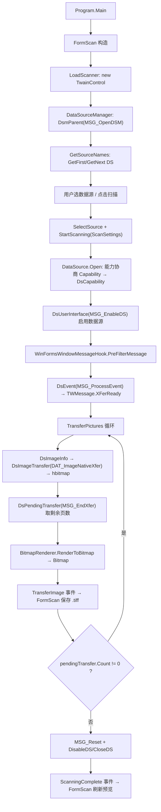

# Scanner

一个基于 **.NET Framework 4.5.2 + WinForms** 的 Windows 桌面扫描程序，通过 **TWAIN 1.9** 协议直接调用扫描仪驱动，支持枚举数据源、自动进纸器（ADF）双面连续扫描，并把每页图像落盘后在窗体内预览与翻页。

> 本项目是**纯本地桌面应用**：没有服务端、没有网络接口、没有数据库，也不需要任何云资源。唯一的第三方库是日志组件 `log4net 2.0.17`。

---

## 目录

- [1. 项目概览](#1-项目概览)
- [2. 解决方案与工程结构](#2-解决方案与工程结构)
- [3. 架构与核心模块](#3-架构与核心模块)
- [4. 一次扫描的完整调用链](#4-一次扫描的完整调用链)
- [5. 配置、参数与产物](#5-配置参数与产物)
- [6. 构建与环境要求](#6-构建与环境要求)
- [7. 运行前置条件与使用说明](#7-运行前置条件与使用说明)
- [8. 已知限制与注意事项](#8-已知限制与注意事项)
- [9. 依赖清单](#9-依赖清单)
- [10. 常见问题排查](#10-常见问题排查)
- [11. 变更记录](#11-变更记录)
- [12. 许可证](#12-许可证)

---

## 1. 项目概览

| 项目 | 内容 |
| --- | --- |
| 应用类型 | Windows 窗体应用（`WinExe`），单窗体 `FormScan` |
| 目标框架 | .NET Framework **4.5.2**（`supportedRuntime v4.0 / sku .NETFramework,Version=v4.5.2`） |
| 工程格式 | 旧式非 SDK `.csproj`（`ToolsVersion="15.0"`），解决方案 `Format Version 12.00 / VS17` |
| 主要语言 | C#（WinForms / `System.Drawing` / P/Invoke） |
| 扫描协议 | TWAIN **1.9**，通过 `twain_32.dll` 的 `DSM_Entry` 序号导出 `#1` 调用 |
| 图像传输 | Native DIB（内存位图句柄），经 `BitmapRenderer` 转成 GDI+ `Bitmap` |
| 图像输出 | 每页一个独立文件，GUID 命名，扩展名 `.tiff`，存于 `<程序目录>\image` |
| 日志 | `log4net 2.0.17`，按大小 + 日期复合滚动文件（`logs/scanner.log`，级别 INFO，已移除控制台 appender） |
| 配置方式 | 无 `appSettings`、无命令行参数；扫描参数在 `Scanner/FormScan.cs` 中硬编码 |
| 程序集版本 | `1.0.0.0`（4 个工程一致），版权标记 `Copyright ©  2024` |
| 测试 / CI | 无单元测试工程、无 CI 脚本、无安装/发布脚本 |
| 许可证 | MIT，见 [`LICENSE`](LICENSE) |

**它做什么**：启动 → 枚举本机 TWAIN 数据源并填入下拉框 → 用户选扫描仪点「扫描」→ 以 ADF + 双面 + 300dpi 彩色参数启动扫描 → 驱动每传回一页就保存一张图片 → 扫描结束后在「微缩视图 / 垂直视图」中分页预览。

**它不做什么**：不生成 PDF、不合成多页 TIFF、不提供图像编辑/OCR、不上传或同步、不提供配置界面、不需要登录。

---

## 2. 解决方案与工程结构

`Scanner.sln` 包含 4 个工程，只有 `Debug` 与 `Release` 两种解决方案配置；各工程的 `PlatformTarget` 已统一固定为 **`x86`**（见 [§6.2](#62-平台要求已固定-x86)）：

| 解决方案中的工程名 | 目录 / csproj | 类型 | 程序集名 | 根命名空间 | 目标框架 |
| --- | --- | --- | --- | --- | --- |
| `Scanner` | `Scanner/Scanner.csproj` | WinExe | `Scanner` | `Scanner` | v4.5.2 |
| `Scanner.Twain32` | `Scanner.Twain/Scanner.Twain32.csproj` | Library | **`Scanner.Twain`** | `Scanner.Twain` | v4.5.2 |
| `Scanner.Toolkit` | `Scanner.Toolkit/Scanner.Toolkit.csproj` | Library | `Scanner.Toolkit` | `Scanner.Toolkit` | v4.5.2 |
| `Scanner.Visual` | `Scanner.Visual/Scanner.Visual.csproj` | Library | `Scanner.Visual` | `Scanner.Visual` | v4.5.2 |

> **命名不一致提示**：解决方案里叫 `Scanner.Twain32`，csproj 文件名也是 `Scanner.Twain32.csproj`，但目录是 `Scanner.Twain/`，编译产物和命名空间却是 `Scanner.Twain`。检索代码时请以 `Scanner.Twain` 命名空间为准。

**依赖关系**（单向星型，只有主工程引用其余 3 个库，库之间互不引用）：

```text
Scanner (WinExe, 主程序)
 ├── Scanner.Toolkit   —— 路径/文件/系统工具
 ├── Scanner.Twain32  —— TWAIN 协议封装（程序集 Scanner.Twain.dll）
 └── Scanner.Visual   —— 分页 UserControl
```

全部系统引用均为 .NET Framework BCL（`System`、`System.Drawing`、`System.Windows.Forms`、`System.Net.Http`、`System.Web`、`System.Xml*` 等）。仅 `Scanner` 与 `Scanner.Twain32` 通过 `HintPath` 引用 `..\packages\log4net.2.0.17\lib\net45\log4net.dll`。4 个工程均无强名称签名、无 `AllowUnsafeBlocks`、无 `StartupObject`、无应用图标。

### 目录树（源码部分）

```text
Scanner/
├── Scanner.sln                 解决方案
├── .gitignore / .gitattributes
├── LICENSE                    MIT 许可证
├── README.md                  本文档
├── packages/                   NuGet 还原产物（log4net.2.0.17）
├── Scanner/                    主程序（8 个 .cs）
│   ├── Program.cs              [STAThread] Main 入口
│   ├── FormScan.cs             主窗体：扫描调度、图片落盘、预览分页、控件等比缩放
│   ├── FormScan.Designer.cs    WinForms 设计器代码（中文 UI 文本硬编码于此）
│   ├── WinFormsWindowMessageHook.cs   IMessageFilter ↔ TWAIN 消息钩子桥接
│   ├── App.config              log4net + supportedRuntime
│   ├── packages.config         log4net 2.0.17 / net452
│   └── Properties/             AssemblyInfo / Resources / Settings（后两者为空模板）
├── Scanner.Twain/              TWAIN 协议封装（65 个 .cs，核心）
│   ├── *.cs                    门面、会话、能力协商、设置、事件参数、异常（22 个）
│   ├── Twain32Native/          TWAIN 结构体、枚举、常量与 [DllImport]（37 个）
│   ├── Win32Native/            Kernel32/Gdi32/User32 P/Invoke、DIB→Bitmap（6 个）
│   ├── App.config / packages.config
│   └── Properties/AssemblyInfo.cs
├── Scanner.Toolkit/            通用工具类（6 个 .cs）
│   ├── FilePath.cs             路径拼接（自动建目录）、文件操作、图片格式/扩展名互转
│   ├── OSHelper.cs             进程、注册表、ACL、TCP/ICMP Ping、端口检测
│   ├── ScriptUtil.cs           FIPS 开关、启动/结束进程、`lisscanner` URL 协议注册
│   ├── StringHelper.cs / Naming.cs
│   └── Properties/AssemblyInfo.cs
└── Scanner.Visual/             WinForms 用户控件（3 个 .cs）
    └── PageControl.cs          带 `<< < > >>` 按钮与「第 N/M 页」标签的分页控件
```

---

## 3. 架构与核心模块

### 3.1 `Scanner.Twain` —— TWAIN 1.9 协议封装（项目核心，65 个源文件）

按层次划分为 4 层：

| 层 | 关键类型 | 职责 |
| --- | --- | --- |
| **门面层** | `TwainControl` | 对外唯一入口：`GetSourceNames` / `GetDefaultSourceName` / `SelectSource` / `StartScanning`；只暴露 `TransferImage`、`ScanningComplete` 两个事件（其余事件在源码中被注释保留） |
| **会话层** | `DataSourceManager`、`DataSource`、`Capability`、`CapabilityResult`、`ScanSettings` 及 `Area/Page/Resolution/RotationSettings`、`IWindowsMessageHook`、7 个 `EventArgs`、`TwainException` / `FeederEmptyException`、`Diagnostics` | DSM 生命周期、数据源枚举、能力协商、WinForms 消息循环驱动、多页传输循环 |
| **TWAIN Native 层** | `Twain32Native`（11 个 `DllImport("twain_32.dll", EntryPoint="#1")`）、`Identity`、`TwainVersion`、`UserInterface`、`Event`、`ImageInfo`、`ImageLayout`、`Frame`、`Fix32`、`Status`、`PendingXfers`、`TwainCapability` / `CapabilityOneValue` / `EnumValue` / `ArrayValue` | TWAIN 数据结构（`[StructLayout(LayoutKind.Sequential, Pack=2)]`）与常量全表：`Capabilities`、`TWMessage`、`DataArgumentType`、`DataGroup`、`TwainResult`、`ConditionCode`、`TwainType`、`ContainerType`、`PixelType`、`PageType`、`ImageFileFormat`、`Units`、`Country`、`Language` 等；`TwainConstants` 声明协议版本 1.9 |
| **Win32 层** | `Kernel32Native`（`GlobalAlloc/Lock/Unlock/Free`）、`Gdi32Native`（`SetDIBitsToDevice`）、`User32Native`（`GetMessagePos/Time`）、`BitmapInfoHeader`、`WindowsMessage`、`BitmapRenderer` | 把 TWAIN 返回的全局内存 DIB 句柄渲染成 GDI+ `Bitmap`，并换算 DPI（`PpmToDpi`） |

要点：

- `Twain32Native` 中的 11 个 P/Invoke 全部映射到同一个 `DSM_Entry` 序号导出，靠 `DataGroup / DataArgumentType / TWMessage` 三元组区分操作（`OpenDSM`、`OpenDS`、`EnableDS`、`ProcessEvent`、`ImageNativeXfer`、`EndXfer`、`Reset`、`Get/Set Capability` 等）。
- `DataSource.Open(ScanSettings)` 会按固定顺序协商十余项能力：进度指示、传输页数、ADF、双面、纸张尺寸、方向、扫描区域、色彩、分辨率、旋转、边框检测。不支持某项能力时代码用空 `catch { }` 跳过（驱动兼容性策略），因此不同厂商扫描仪的实际效果会有差异。
- `TwainCapability` 目前只实现 `CapabilityOneValue` 容器（`GlobalAlloc/GlobalLock/Marshal.StructureToPtr`），`EnumValue` / `ArrayValue` 结构体虽已定义但协商流程未使用。
- 传输机制**固定为 Native DIB**（`DAT_ImageNativeXfer`）。`TransferMechanism` 与 `ImageFileFormat` 枚举仅是 TWAIN 常量定义，流程中从未设置，因此没有 File/Memory 传输，也没有 TWAIN 侧的文件格式协商。
- `BitmapRenderer` 早期版本依赖 `Debug.Assert(Marshal.SizeOf(typeof(IntPtr)) == 4)` 与 `ToInt32()`，并注释 `// The following code only works on x86`；现已改为基于 `IntPtr.Add` 的指针运算，可在 32/64 位进程下正确计算像素偏移（见 [§6.2](#62-平台要求已固定-x86)）。

### 3.2 `Scanner` —— 主程序（WinForms）

- `Program.Main()`：`[STAThread]`，仅 `EnableVisualStyles` → `SetCompatibleTextRenderingDefault(false)` → `Application.Run(new FormScan())`。**无参数、无命令行解析**。
- `FormScan` 构造：初始化分页控件 → 注册窗体 `Resize` 实现控件等比缩放（`SetTag/SetControls/ReWinformLayout`）→ `LoadScanner()` 创建 `TwainControl` 并枚举数据源绑定下拉框 → **清空 `<程序目录>\image` 下的全部文件**。
- `LoadScanner()` 订阅两个事件：`TransferImage` 把 `args.Image` 以 `Guid.NewGuid() + ".tiff"` 保存到 `image` 目录；`ScanningComplete` 恢复窗体、切回第一个预览 Tab 并重新加载图片列表，并读取 `args.Exception` 在扫描失败时提示。创建 `TwainControl` 失败时记录日志并弹出错误提示。`TwainControl` 在窗体 `FormClosing` 时 `Dispose`，释放 DSM 与消息过滤器。
- 扫描按钮 `bntScan_Click`：先校验 `_twain` 已初始化且下拉框已选数据源（否则给出提示并直接返回，避免窗体被永久禁用），随后 `_twain.SelectSource` 与 `StartScanning` 统一包在 `try` 中，失败时恢复窗体可用状态并提示。
- 预览：`Image.FromFile` → `ImageList`/`ListView`（微缩视图，分页）与 `PictureBox.Load`（垂直视图）。原设计器中的第 3 个「水平视图」Tab 已移除（事件 `switch` 只处理 case 0/1，该 Tab 无实际功能）。
- `WinFormsWindowMessageHook`：实现 `IWindowsMessageHook` 与 `IMessageFilter`，通过 `Application.AddMessageFilter` 把 Win32 消息转发给 TWAIN DSM，这是无 UI 扫描（`ShowTwainUI=false`）能收到 `XFerReady` 的关键。

### 3.3 `Scanner.Toolkit` —— 通用工具

`FilePath`（约 656 行）提供应用/日志/数据/临时/更新等路径获取、`PathCombine`（去掉开头反斜杠、**自动创建目录**、返回值以 `\` 结尾）、文件增删改查与 ACL、`GetPictureList`（`.jpg/.bmp/.png/.tif/.gif/.tiff`）、`GetImageFormatExtension` / `GetImageFormat` / `IsImageFormat`（Bmp/Emf/Exif/Gif/Icon/Jpeg/Png/Tiff/Wmf 互转）。`OSHelper` 提供进程、注册表、`RegSvr/RegAsm`、Everyone/Users 授权、TCP/ICMP `Ping` 与端口占用检测。`ScriptUtil` 提供 FIPS 开关、进程控制与 `lisscanner://` URL 协议注册（指向 `Scanner.exe`）。

> 主程序实际只用到 `Scanner.Toolkit` 的 `FilePath`；`OSHelper`、`ScriptUtil` 属于未被主流程调用的遗留工具代码（`ScriptUtil` 为 `internal`）。这些涉及 HKLM/HKCR 注册表与 ACL 的方法若被调用通常需要管理员权限。

### 3.4 `Scanner.Visual` —— 分页控件

`PageControl : UserControl`，暴露 `TotalPages / CurrentPage / PageSize` 与 `ClickPageButtonEvent` / `ChangedPageSizeEvent`，提供首页/上一页/下一页/末页四个按钮及「第1/1页」标签。UI 文本（含宋体字体）硬编码在 `PageControl.Designer.cs`。

---

## 4. 一次扫描的完整调用链



分步说明（关键位置）：

1. `Scanner/Program.cs:12` `Main()` → `Application.Run(new FormScan())`。
2. `Scanner/FormScan.cs` `LoadScanner()` → `new TwainControl(new WinFormsWindowMessageHook(this))` → `Scanner.Twain/TwainControl.cs` 创建 `DataSourceManager` → `DataSourceManager.cs` `DsmParent(MSG_OpenDSM)`；创建失败时记录日志并通过 `MessageBox` 提示用户（不再静默吞掉）。
3. `TwainControl.GetSourceNames()` → `DataSource.GetAllSources()` 遍历 DS 名称并填充 `cbbDataSource`。
4. `FormScan.cs:139` 扫描按钮：硬编码 `ScanSettings`（ADF/双面/300dpi 彩色/不显示驱动 UI/传输全部页）→ `TwainControl.StartScanning` → `DataSourceManager.StartScan` → `DataSource.Open` 能力协商 → `Enable(MSG_EnableDS)`。
5. TWAIN 消息经 `WinFormsWindowMessageHook` → `DataSourceManager.FilterMessage` → `DsEvent(MSG_ProcessEvent)`；收到 `XFerReady` 时进入 `TransferPictures()`。
6. `DataSourceManager.cs:170-242`：循环调用 `DsImageInfo` / `DsImageTransfer` / `DsPendingTransfer(EndXfer)`，把 DIB 交给 `BitmapRenderer` 渲染，触发 `TransferImage` 事件；`while (pendingTransfer.Count != 0)` 实现 ADF 连续多页；`finally` 中 `MSG_Reset` 清理。
7. `FormScan.cs` 的 `TransferImage` 事件处理器用 `using (Bitmap)` 释放每页图像，并以 `ImageFormat.Tiff` 显式保存为 `<程序目录>\image\<GUID>.tiff`；`ScanningComplete` 后 `DefaultShowImage()` 重新枚举目录并分页渲染，并在携带异常时提示。
8. 关闭时 `DataSource.Close()`（DisableDS → CloseDS）、`DataSourceManager.Dispose()`（CloseDSM、释放消息过滤器），以及 `TwainControl.Dispose()`（`FormClosing` 时触发）释放 `DataSourceManager`。

---

## 5. 配置、参数与产物

### 5.1 扫描参数（源码硬编码，无配置项）

`Scanner/FormScan.cs:155-168`：

| 参数 | 值 | 含义 |
| --- | --- | --- |
| `UseDocumentFeeder` | `true` | 使用自动进纸器 ADF |
| `UseDuplex` | `true` | 双面扫描 |
| `Resolution` | `ResolutionSettings.ColourPhotocopier` | 300 dpi 彩色（另有 Fax 200dpi、Photocopier 300dpi 灰度预设） |
| `ShowTwainUI` | `false` | 不显示厂商驱动界面 |
| `ShowProgressIndicatorUI` | `false` | 不显示进度指示 |
| `ShouldTransferAllPages` | `true` | 传输全部页（`TransferAllPages = -1`） |
| `Area` | `null` | 不限制扫描区域（默认纸张 `UsLetter`） |
| `Rotation` | `AutomaticRotate=false`, `AutomaticBorderDetection=false` | 关闭自动纠偏与边框检测 |

想改参数只能修改源码后重新编译。`Scanner/Properties/Settings.settings` 是空的 VS 模板，全库无 `appSettings` 节、无 `ConfigurationManager` 调用。

### 5.2 log4net 配置

`Scanner/App.config` 与 `Scanner.Twain/App.config` 内容几乎相同（后者日志文件为 `logs/twain.log`）：

- `configSections` 声明 `log4net` 节（必须置于 `configuration` 第一个节点）。
- 两个 Appender：早期版本为 `ConsoleAppender` + `RollingFileAppender`；现已移除控制台 appender，仅保留 `RollingFileAppender`，输出到 `logs/scanner.log`，`appendToFile=true`、`maximumFileSize=5120KB`、`maxSizeRollBackups=10`、`RollingStyle=Composite`（同时按大小与时间滚动）、`LevelRangeFilter` 为 DEBUG~FATAL、`root level=INFO`。`Scanner.Twain/App.config` 同理（日志文件为 `logs/twain.log`）。
- `<startup><supportedRuntime version="v4.0" sku=".NETFramework,Version=v4.5.2" /></startup>`（仅主工程 App.config 有）。
- `[assembly: log4net.Config.XmlConfigurator(ConfigFileExtension="config", Watch=true)]` 位于 `Scanner/Properties/AssemblyInfo.cs` 与 `Scanner.Twain/Properties/AssemblyInfo.cs`，使配置热更新生效。

### 5.3 运行时产物

| 产物 | 位置 | 说明 |
| --- | --- | --- |
| 扫描图片 | `<exe 目录>\image\<GUID>.tiff` | 由 `FilePath.PathCombine(FilePath.GetAppPath(), "\\image")` 得到，目录不存在时自动创建 |
| 日志 | `<exe 目录>\logs\scanner.log`（复合滚动） | `scanner.log` 或 `scanner.log.YYYY-MM-DD`，最大 5 MB / 保留 10 份，级别 INFO |
| 编译输出 | 各工程 `bin\Debug\` / `bin\Release\` | `Scanner.exe`、`Scanner.Twain.dll`、`Scanner.Toolkit.dll`、`Scanner.Visual.dll`、`log4net.dll` + `.config` |
| 中间产物 | 各工程 `obj\` | `.cache`、`.pdb`、`.resources` 等 |

> **重要**：`FormScan` 构造函数会删除 `image` 目录中的**全部文件**，即每次启动程序都会清空上一次的扫描结果。需要留存的扫描件请在关闭程序前复制到别处。

---

## 6. 构建与环境要求

### 6.1 需要的环境

| 项 | 要求 |
| --- | --- |
| 操作系统 | Windows（依赖 `twain_32.dll`、`System.Windows.Forms`、GDI+、注册表） |
| IDE / 工具 | Visual Studio 2017+（`.sln` Format 12.00 / VS17，`ToolsVersion 15.0`）或等效 MSBuild |
| .NET | **.NET Framework 4.5.2 Developer Pack / Targeting Pack**（编译必需）；运行需 .NET Framework 4.5.2 及以上运行时 |
| NuGet | 需要还原 `packages.config` 中的 `log4net 2.0.17` |
| 扫描仪驱动 | 厂商提供的 **32 位 TWAIN 驱动**（见下节） |

### 6.2 平台要求：已固定 x86（最关键）

- 各工程 `PlatformTarget` 现已统一固定为 **`x86`**（`Scanner.csproj` 公共 `PropertyGroup` 与 `Debug|Release` 配置段、`Scanner.Twain32.csproj` 公共 `PropertyGroup` 均已写入 `<PlatformTarget>x86</PlatformTarget>`），无需再手动调整。
- `Scanner.Twain/Twain32Native/Twain32Native.cs` 全部 `DllImport("twain_32.dll")` 指向 **32 位 TWAIN DSM**；`Scanner.Twain/Win32Native/BitmapRenderer.cs` 已改为基于 `IntPtr.Add` 的指针运算，不再依赖 `ToInt32()` 的 32 位假设。
- **结论**：请始终以 x86 运行；确保扫描仪安装的是 32 位 TWAIN 驱动。使用 `twaindsm.dll` 的 TWAIN 2.x 64 位驱动不在本代码支持范围内（若需支持，需改 DllImport 目标并整体评估 64 位兼容性）。

### 6.3 构建步骤

```powershell
# 1. 还原 NuGet 包（packages.config 模式，会生成 packages/log4net.2.0.17/）
nuget restore Scanner.sln
#    或 VS 中：工具 → NuGet 包管理器 → 还原 NuGet 程序包

# 2. 使用 VS 打开 Scanner.sln，选择 Debug 后生成（各工程已固定 x86）
#    或用 MSBuild（需 VS 开发人员命令提示符 / MSBuild 在 PATH 中）：
msbuild Scanner.sln /p:Configuration=Release /p:Platform="Any CPU"
#    注：Platform 为解决方案配置名，实际输出位数由 csproj 的 PlatformTarget=x86 决定

# 3. 输出
#    Scanner\bin\Release\Scanner.exe 及同目录下 3 个工程 DLL、log4net.dll、*.config
```

> **注意**：`.gitignore` 忽略了 `**/packages/*` 与 `*.nupkg`，而 `Scanner.csproj` / `Scanner.Twain32.csproj` 的 `HintPath` 直接硬编码为 `..\packages\log4net.2.0.17\lib\net45\log4net.dll`。**干净克隆后必须先执行 NuGet 还原**，否则会因找不到 `log4net.dll` 而编译失败。

### 6.4 项目文件约定

- `.gitattributes` 中只有 `* text=auto` 生效，其余 `diff=csharp`、`merge=binary`、图片 `binary` 等规则均被注释，属于 VS 模板默认状态。
- `.gitignore` 基于 GitHub `VisualStudio.gitignore` 模板，并已补充 IDE / 构建产物忽略规则（见 [§8.8](#88-仓库与工程状态)）。

---

## 7. 运行前置条件与使用说明

1. 安装扫描仪厂商的 **32 位 TWAIN 驱动**，并在 Windows 设备与打印机中确认扫描仪可用（可用系统自带「Windows 传真和扫描」先验证驱动）。
2. 确保 `Scanner.exe` 所在目录**可写**（程序会创建 `image`、`logs` 子目录）。
3. 双击 `Scanner.exe` 启动。程序会枚举数据源并填入左上角下拉框；若下拉框为空或初始化失败，程序会弹出错误提示（早期版本会静默失败），多半是 `twain_32.dll`/DSM 打开失败或未装 32 位驱动，可查看 `logs/scanner.log` 排查。
4. 选择扫描仪，点击「扫描」。ADF 中的纸张会被逐页扫描，每页生成一个 `.tiff`。
5. 扫描完成后切回「微缩视图」，用分页控件或「上一张 / 下一张」浏览；「垂直视图」以单张大图显示当前图片。
6. 关闭程序前，把需要的图片从 `image` 目录复制出去 —— 下次启动会被清空。

**无需**：命令行参数、网络连接、数据库连接、账号登录、管理员权限（除非手动调用 `Scanner.Toolkit` 中写注册表/ACL 的遗留工具方法）。

---

## 8. 已知限制与注意事项

### 8.1 平台与驱动
- 各工程 `PlatformTarget` 已统一固定为 `x86`，与 32 位 `twain_32.dll` / x86 位图渲染代码保持一致（[§6.2](#62-平台要求已固定-x86)）。
- 未安装数据源 / 初始化失败时 `DataSourceManager` 会抛 `TwainException`，`FormScan.LoadScanner()` 现已捕获并弹出错误提示，不再静默 return。

### 8.2 图像输出
- 文件名后缀是 `.tiff`，`FormScan.cs` 的 `TransferImage` 现已显式以 `ImageFormat.Tiff` 保存（`using (Bitmap)` 释放），编码为单页 TIFF；不要假定它是标准多页 TIFF 或带压缩的 TIFF。
- **不支持 PDF / 多页 TIFF 导出**：`ImageFileFormat` 枚举中的 `TiffMulti / Png / Jpeg / Pdf / PdfA / PdfA2` 只是 TWAIN 协议常量，从未在传输流程中使用。
- 每页一个独立文件，文件名为随机 GUID，无排序元数据；`DefaultShowImage()` 按 `DirectoryInfo.GetFiles()` 顺序读取，预览顺序不保证与扫描顺序一致。

### 8.3 UI 与交互
- 「水平视图」Tab 原在设计器中占位、但 `FormScan.cs` 的 Tab 切换 `switch` 只处理 case 0/1（无实际功能），现已从设计器移除该 Tab。
- 分页大小已统一为 `20`（`FormScan.cs` 的 `pageSize` 字段与 `DefaultPageControl.PageSize` 一致）。
- 中文界面文本硬编码在 `*.Designer.cs`（`"扫描"`、`"微缩视图"`、`"垂直视图"`、`"下一张"`、`"第1/1页"` 等，字体宋体），`.resx` 仅为 VS 模板内容，无本地化资源，因此界面只有简体中文。
- 扫描过程中窗体被整体 `Enabled = false`，直到 `ScanningComplete` 触发或 `SelectSource` / `StartScanning` 抛异常被捕获后才恢复，避免了早期「空数据源直接 return」导致的永久禁用。

### 8.4 错误处理与日志
- `DataSource.cs` 有十余处空 `catch { }`，用于「驱动不支持该能力则跳过」，属于兼容性策略；`DataSourceManager` 中 `throw e` 已改为 `throw`，保留原始堆栈；`FilePath`/`OSHelper` 的 `throw ex;` 也已改为 `throw;`。
- `FormScan` 构造 `TwainControl` 失败时会提示用户；扫描异常除弹窗外，会在 `ScanningComplete` 中读取 `args.Exception` 给出提示，传输期异常不再被静默吞掉。
- `Capability.cs` 的 `string.Format` 格式串占位符已修正，`_twainType` 能正确打印。
- 日志已改为 `root level=INFO` 且仅输出文件（移除控制台 appender），长期使用体积可控（5 MB × 10 份复合滚动）。

### 8.5 安全与权限
- 无强名称签名、无代码签名、无加密或认证逻辑。
- `Scanner.Toolkit` 中涉及系统级变更的遗留工具方法（`ScriptUtil` 的 `DisableFips` 写 HKLM、`RegUrlProtocol` 注册 `lisscanner://` 协议、`OSHelper` 给 Everyone/Users 赋 FullControl 的 `AddSecurityControll2Folder`）已从代码库中**删除**；当前 `OSHelper`/`ScriptUtil` 仅保留进程/注册表读取、FIPS 开关、进程控制等低风险工具方法，且主流程未调用，属遗留代码。

### 8.6 配置能力
- 无 `appSettings`、无命令行参数、无外部配置文件（除 log4net 节）。所有扫描参数、输出目录、分页大小都写死在源码里。
- `AutoGenerateBindingRedirects=true` 已设置，但当前 `App.config` 无 `bindingRedirect`（也无 `System.Net.Http` 等版本冲突需求），产物 `.config` 与源文件一致。

### 8.7 工程与质量
- 无单元测试、无 CI/CD、无 CHANGELOG、无安装程序；`Scanner.Visual/bin/Release/` 为空目录（从未构建过 Release 产物）。
- 4 个 `AssemblyInfo.cs` 的 `AssemblyCompany` 为空，`AssemblyCopyright("Copyright ©  2024")` 为 VS 模板遗留；程序集版本统一 `1.0.0.0`。
- TWAIN 应用标识由 `DataSourceManager.DefaultApplicationId` 构造：`Manufacturer/ProductFamily/ProductName = "Scanner"`，版本 1.1，`Language.USA / Country.USA`，Id 由 GUID 生成。

### 8.8 仓库与工程状态
- 各工程 `bin/`、`obj/` 下存在本机 Debug 产物，以及历史滚动日志（`logs/scanner.log.2024-05-19` 等）和 6 个 `.tiff` 扫描样张；这些均已被 `.gitignore` 覆盖，不属于源码。
- `.gitignore` 基于 GitHub `VisualStudio.gitignore` 模板，本次补充了 `.idea/`、`*.iml` / `*.ipr` / `*.iws`、`target/`、`.vscode/`、`.settings/` / `.classpath` / `.project` 等 IDE 与构建产物规则；模板原有的 `.vs/`、`[Bb]in/`、`[Oo]bj/`、`[Oo]ut/`、`*.pdb`、`*.[Cc]ache` 等规则继续生效。

---

## 9. 依赖清单

| 依赖 | 版本 | 引入方式 | 用途 |
| --- | --- | --- | --- |
| .NET Framework | 4.5.2 | 框架引用 | BCL、WinForms、GDI+ |
| `log4net` | 2.0.17（`net45`） | `packages.config` + `HintPath` | 日志记录（主工程与 TWAIN 库） |
| `twain_32.dll` | 系统 / 驱动提供 | P/Invoke `EntryPoint="#1"` | TWAIN 1.9 DSM 入口 |
| `kernel32.dll` / `gdi32.dll` / `user32.dll` | 系统 | P/Invoke | 全局内存、DIB 绘制、消息位置/时间 |

`packages/log4net.2.0.17/` 内含 `.nupkg`、签名文件、图标，以及 7 个目标框架目录（`net20 / net35 / net40 / net40-client / net45 / netstandard1.3 / netstandard2.0`）各一份 `log4net.dll` 与 `log4net.xml`；工程实际引用的是 `lib/net45/log4net.dll`。无其他 NuGet 包、无 `Quartz/RestSharp/Fleck/Newtonsoft.Json/SnmpSharpNet/BouncyCastle` 等依赖，也无 HTTP/WebSocket/SNMP 服务或端口监听（`OSHelper.Ping/PortInActive` 只是未被调用的工具方法）。

---

## 10. 常见问题排查

| 现象 | 可能原因 / 处理 |
| --- | --- |
| 编译时报找不到 `log4net.dll` | `packages/` 被 `.gitignore` 忽略，干净克隆后未还原。执行 `nuget restore Scanner.sln` 或在 VS 中还原 NuGet 包 |
| 编译时报 `.NETFramework,Version=v4.5.2` 找不到 | 未安装 .NET Framework 4.5.2 Developer Pack（Targeting Pack），安装后再构建；`dotnet build` 不适用于旧式 .NET Framework 工程 |
| 启动后数据源下拉框为空 | 未安装 32 位 TWAIN 驱动 / DSM 打开失败。程序现在会弹出错误提示，可查看 `logs/scanner.log` 获取详细原因；先用系统「Windows 传真和扫描」验证驱动，再确认以 x86 运行 |
| `BadImageFormatException` 或位图渲染异常 | 以 64 位进程运行了 x86 专用代码（见 [§6.2](#62-平台要求请按-x86-编译运行最关键)） |
| 点击扫描提示「没有可用的扫描仪」 | 下拉框为空，同上；或 `cbbDataSource.SelectedItem` 为空 |
| 上次扫描的图片不见了 | 设计如此：每次启动清空 `<exe 目录>\image`，见 [§5.3](#53-运行时产物) |
| 找不到 PDF / 合并后的多页文件 | 当前实现每页单独存盘，不生成 PDF 或多页 TIFF |
| 扫描中途窗体一直灰掉 | 早期若驱动异常未发完成事件会一直禁用；现已把 `SelectSource` / `StartScanning` 包进 `try`，异常时恢复窗体可用状态。若仍卡死，多为驱动未发 `ScanningComplete`，查看 `logs/scanner.log` 后重启程序 |
| 日志没有生成 | 检查 `logs/` 目录写权限、`App.config` 中 `configSections` 是否位于第一个节点、`log4net.dll` 是否与 `.exe` 同目录 |

---

## 11. 变更记录

### 2026-11（稳定性与资源释放修复）

针对代码审查发现的问题，本次提交修复了以下缺陷（详见提交记录）：

- **核心稳定性**：无数据源 / 未初始化时点击「扫描」不再导致窗体被永久禁用；`LoadScanner` 初始化失败弹出错误提示而非静默 return；`ScanningComplete` 读取 `args.Exception` 并在扫描失败时提示；`_twain` 空守护。
- **资源释放**：`TransferImage` 用 `using (Bitmap)` 释放每页位图，`image.Save` 显式指定 `ImageFormat.Tiff`；`Capability` 能力协商用 `using` 释放 `GlobalAlloc` 的 native 内存；`DataSource.Dispose` 不再依赖 `disposing` 标志、关闭后清空源标识防重复关闭；`TwainControl` 实现 `IDisposable`，窗体 `FormClosing` 时释放 `DataSourceManager`（含消息过滤器）。
- **平台**：各工程 `PlatformTarget` 固定为 `x86`（消除与 32 位 `twain_32.dll` 的冲突）；`BitmapRenderer` 改用 `IntPtr.Add` 计算像素偏移，移除仅 Debug 的 x86 断言，避免 64 位进程指针截断。
- **异常处理 / 日志**：`ScanningComplete` 不再静默吞异常；`DataSource` 日志类别修正为 `typeof(DataSource)`；`Capability` 格式串占位符修正；`throw e` / `throw ex;` 改为 `throw`。
- **UI**：移除未实现的「水平视图」Tab；分页大小统一为 20；ImageList 先绑定再释放源图；移除控件缩放时抢焦点。
- **清理**：删除 `OSHelper.AddSecurityControll2Folder`、`ScriptUtil.RegUrlProtocol/UnRegUrlProtocol` 等危险/未使用死代码；修正 `RegSvr` 命令拼接缺少空格；log4net 改为 `Composite` 滚动、移除无意义的 `Console` appender、级别调为 `INFO`。

---

## 12. 许可证

本项目采用 **MIT License**，版权所有 `Copyright (c) 2026 wxingfu`。完整条款见 [`LICENSE`](LICENSE)。

---

*本文档基于仓库当前源码静态分析编写；所列行号与行为以实际代码为准，代码变更时请同步更新。*
